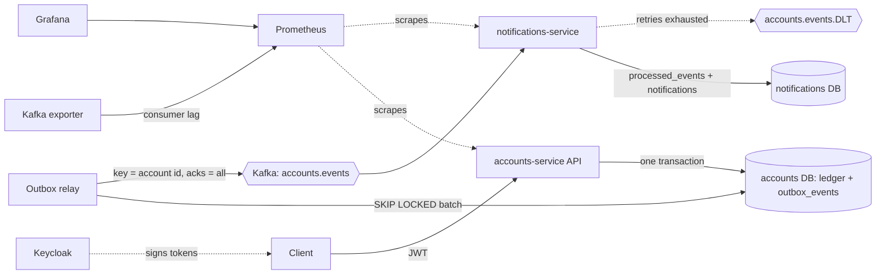
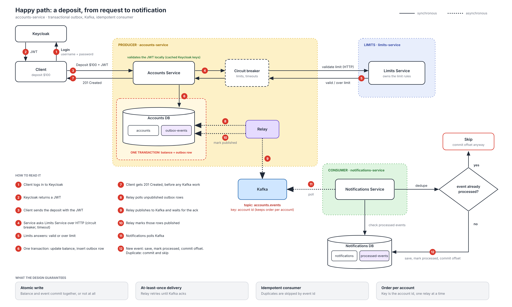
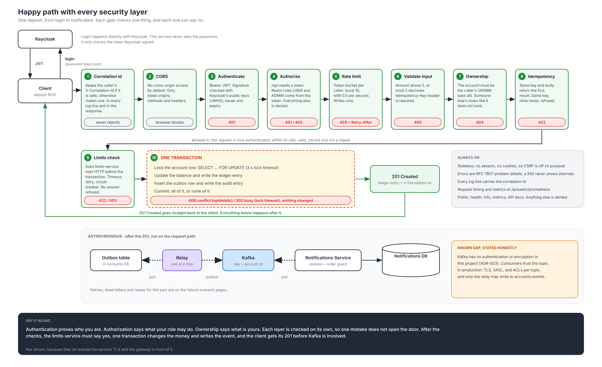

# accounts-service

Banking accounts service built with Spring Boot 4, PostgreSQL and Testcontainers: ledger, safe money movement under
concurrency, a validated REST API, idempotent money operations, JWT security with Keycloak and reliable events through a
transactional outbox to Kafka, consumed by a second service, `notifications-service`. Profile reads are cached, and a
synchronous call to a third service, `limits-service`, is
protected with timeouts, retry and a circuit breaker.


I built this to practice the problems that come up in real backend work: moving money correctly under concurrency,
publishing events reliably, and proving behavior with tests against real infrastructure. Everything in here is code I
wrote and can explain.

## What it shows

Built:

- **Correct money movement.** Deposit, withdraw and transfer with a ledger entry for every balance change, saved in the
  same transaction. Pessimistic locking with ordered locks for balances, optimistic locking for profiles. See ADR-001.
- **Real tests.** PostgreSQL runs in Testcontainers, no H2. Concurrency tests prove there are no lost updates or
  deadlocks.
- **A clean REST API.** Thin controllers, Bean Validation and one error format (RFC 9457 `ProblemDetail`). Services
  return read models mapped with MapStruct, so entities never reach the web layer. The ledger endpoint caps the page
  size and only sorts by whitelisted fields.
- **Safe retries.** Deposits, withdrawals and transfers need an `Idempotency-Key`. The key is stored in PostgreSQL in
  the same transaction as the
  transfer, so a repeated request returns the first result and money moves once, even for concurrent duplicates. Keys
  expire
  after 24 hours and a scheduled job deletes them. A key belongs to its caller, so users can send the same header
  value without interfering, and nobody can replay someone else's key.
- **Rate limiting.** Each caller (the `sub` claim of the token) gets a token bucket for write requests: a burst
  of 10 that refills at 0.5 requests per second by default, set under `app.rate-limit`. When the bucket is empty the
  API answers `429` with a `Retry-After` header, in the same problem+json format as every other error. Reads are not
  limited. Rejections are counted in `ratelimit_rejected_total`.
- **Cross-cutting basics.** A correlation id filter, request timing interceptor, configurable CORS and an `@Audited`
  aspect for money operations.
- **Documented API.** OpenAPI docs and Swagger UI generated with springdoc.
- **Secure by default.** A stateless OAuth2 resource server validating Keycloak tokens, roles from the token and
  ownership checks, so users only see their own customers and accounts.
- **Reliable events.** Every deposit, withdrawal and transfer writes an event to an `outbox_events` table in the same
  transaction as the money movement. A relay publishes the rows to Kafka (`accounts.events`), keyed by account id so
  one account's events stay in order. Delivery is at-least-once: a crash can send an event twice, so consumers must
  ignore duplicates by `event-id`.
- **A second service.** `notifications-service` is its own Spring Boot app with its own database. It reads
  `accounts.events` in a consumer group and turns events into notifications. It stores the event id and the
  notification in one transaction (`insert ... on conflict do nothing`), so a redelivered or concurrent duplicate
  changes nothing. A failing message is retried, then published to `accounts.events.DLT` with the error in its
  headers; a message that can never succeed (no event id) goes there at once, so it cannot block its partition.
- **Observability.** Both services expose Micrometer metrics at `/actuator/prometheus`. Prometheus scrapes them, Grafana
  shows a provisioned dashboard, and a Kafka exporter provides consumer lag. Custom metrics cover the outbox backlog and
  the age of the oldest unpublished event, publish failures, processed and duplicate events, and dead-lettered messages.
  Seven alert rules watch the pipeline. See ADR-005.
- **Caching.** Profile reads (`GET /customers/{id}/profile`: name and email only) are cached with Caffeine, up to 1000
  entries for 5 minutes by default, set under `app.cache`. Balances and accounts are never cached, and the ownership
  check runs before the cache on every request. Changing a name evicts the entry. Hits and misses show up as
  `cache_gets_total`. See ADR-002.
- **Resilience.** Before money moves, accounts-service asks `limits-service` whether the amount is allowed. The call
  runs outside the database transaction, with a 500 ms connect and 1 s read timeout, a retry with exponential backoff
  and jitter, and a circuit breaker (Resilience4j). If limits cannot answer, the operation is refused with `503` and
  `Retry-After` and nothing changes (fail closed); a denial is a `422`. The breaker state is in
  `/actuator/prometheus` and a `LimitsCircuitBreakerOpen` alert watches it. See ADR-004.

## Stack

| Area                 | Technology                                                                                        |
|----------------------|---------------------------------------------------------------------------------------------------|
| Language and runtime | Java 21                                                                                           |
| Framework            | Spring Boot 4.1 (Spring Framework 7), Spring MVC (servlet stack)                                  |
| API                  | REST and JSON, versioned under `/api/v1`, Bean Validation, RFC 9457 `ProblemDetail` errors        |
| API docs             | OpenAPI and Swagger UI with springdoc                                                             |
| Cross-cutting        | Servlet filter (correlation id), `HandlerInterceptor` (timing), Spring AOP (audit), CORS config   |
| Persistence          | Spring Data JPA, Hibernate 7, PostgreSQL 16                                                       |
| Schema migrations    | Liquibase (formatted SQL)                                                                         |
| Mapping              | MapStruct (compile-time, no reflection)                                                           |
| Concurrency          | Pessimistic locking with ordered locks for balances, optimistic locking (`@Version`) for profiles |
| Testing              | JUnit 5, AssertJ, Mockito, MockMvc, Testcontainers (real PostgreSQL, no H2), ArchUnit             |
| Build and quality    | Maven wrapper, Spotless (google-java-format), GitHub Actions CI                                   |
| Messaging            | Transactional outbox, Kafka (KRaft, single broker locally), Spring for Apache Kafka               |
| Resilience           | Resilience4j (retry, circuit breaker), explicit HTTP timeouts, WireMock for failure tests         |
| Observability        | Micrometer, Prometheus, Grafana, Kafka exporter, alert rules in `monitoring/`                     |
| Local tooling        | Docker Compose, Keycloak, Dockerfile, Bruno collection in `bruno/`                                |

**Planned:** distributed tracing.

## Run it

```bash
docker compose up -d                                          # PostgreSQL on 5433, Keycloak on 8180, Kafka on 9092
./mvnw spring-boot:run -Dspring-boot.run.profiles=local       # API on http://localhost:8080
./mvnw verify                                                 # unit and integration tests
```

Try the API with the [Bruno](https://www.usebruno.com/) collection in `bruno/`: open the folder as a collection and
select the `local` environment. Run one of the requests in the `auth` folder first (Get token for alice, bob or admin).
It stores the access token in memory and every other request sends it as a bearer token. Tokens are never written to
a file.

### Identity provider

Keycloak runs in Docker Compose and imports the `accounts` realm from `keycloak/accounts-realm.json`: roles `USER` and
`ADMIN`, users `alice`, `bob` (USER) and `admin` (USER and ADMIN) with the username as the password, and a public client
`accounts-web` for the future React app (Authorization Code with PKCE). These are local development credentials only.
Admin console: http://localhost:8180 (admin / admin).

### Events

Create the topic once after the first `docker compose up`, then watch the events arrive:

```bash
docker exec accounts-kafka /opt/kafka/bin/kafka-topics.sh --bootstrap-server localhost:9092 \
  --create --topic accounts.events --partitions 3 --replication-factor 1

docker exec -it accounts-kafka /opt/kafka/bin/kafka-console-consumer.sh --bootstrap-server localhost:9092 \
  --topic accounts.events --from-beginning --property print.key=true --property print.headers=true
```

Make a deposit with Bruno and the event shows up within a second. The `bruno/events` folder has requests for replays
and transfers. Stop Kafka, make a deposit, start Kafka again: the API keeps working and the events go out afterwards,
in order. The relay settings (`batch-size`, `send-timeout`, `poll-interval`) are under `app.outbox` in
`application.yaml`.

### notifications-service

The consumer lives in `notifications-service/` with its own `pom.xml` and Maven wrapper. It needs its own database
and the dead-letter topic once:

```bash
docker exec accounts-postgres psql -U accounts -d accounts -c "create database notifications;"
docker exec accounts-kafka /opt/kafka/bin/kafka-topics.sh --bootstrap-server localhost:9092 \
  --create --topic accounts.events.DLT --partitions 3 --replication-factor 1

cd notifications-service && ./mvnw spring-boot:run     # port 8090, group "notifications-service"
./mvnw verify                                          # tests use Testcontainers (Kafka and PostgreSQL)
```

Check the group's progress with `kafka-consumer-groups.sh --describe --group notifications-service` and the results
with `select * from notifications` in the `notifications` database.

### limits-service

A small Spring Boot app in `limits-service/` (own `pom.xml` and Maven wrapper, port 8100, no database). It answers
`POST /api/v1/limits/check` with `allowed` and a reason, using the maximum per operation under `app.limits`
(deposit 10000, withdrawal 2000, transfer 5000). accounts-service calls it before every deposit, withdrawal and
transfer, so start it before you try money operations:

```bash
cd limits-service && ./mvnw spring-boot:run            # port 8100
./mvnw verify
```

Failure demo: run the `bruno/resilience` folder with the Bruno runner. It makes limits-service answer in 3 seconds,
sends transfers, shows the first ones taking about 2 seconds (timeout and one retry) and then failing in a few
milliseconds once the circuit breaker is open, then repairs the service and shows the breaker closing again. The
`bruno/limits` folder has the single requests, including the chaos switch (`/admin/chaos`, only while
`app.chaos.enabled=true`). To run accounts-service in Docker, point it at limits with `LIMITS_BASE_URL`.

### Observability

`docker compose up -d` also starts Prometheus, Grafana and a Kafka exporter. Run both apps on the host, then open:

| What       | URL                                     | Notes                                                                   |
|------------|-----------------------------------------|-------------------------------------------------------------------------|
| Prometheus | http://localhost:9090                   | Status > Targets, and Alerts for the rule states                        |
| Grafana    | http://localhost:3030                   | Local only: `admin` / `admin`. Dashboard "Accounts events and services" |
| Metrics    | `/actuator/prometheus` on 8080 and 8090 | The raw numbers Prometheus scrapes                                      |

Try it: stop Kafka (`docker stop accounts-kafka`), make a few deposits with Bruno, and watch the pending events and the
age of the oldest event rise and the `OutboxEventStuck` alert fire. Start Kafka again and both return to zero.
`OutboxPublishFailing` looks at the last 5 minutes, so it stays red a few minutes after recovery. The dashboard and
rules live in `monitoring/`; see [ADR-005](docs/adr/005-observability.md) for what is monitored and why.

API docs: http://localhost:8080/swagger-ui.html (OpenAPI JSON at `/v3/api-docs`).

Health probes for containers and Kubernetes: `/actuator/health/liveness` (is the process alive) and
`/actuator/health/readiness` (can it serve traffic; includes the database). Shutdown is graceful: in-flight requests
get up to 20 seconds to finish.

### Run it in Docker

```bash
docker compose up -d
docker build -t accounts-service .
docker run --rm -p 8080:8080 \
  -e SPRING_DATASOURCE_URL=jdbc:postgresql://host.docker.internal:5433/accounts \
  -e SPRING_DATASOURCE_USERNAME=accounts -e SPRING_DATASOURCE_PASSWORD=accounts \
  -e KEYCLOAK_JWK_SET_URI=http://host.docker.internal:8180/realms/accounts/protocol/openid-connect/certs \
  -e LIMITS_BASE_URL=http://host.docker.internal:8100 \
  accounts-service
```

The image is built in two stages (JDK to build, JRE to run) and runs as a non-root user. Configuration comes from
environment variables, nothing is baked into the image.

## Architecture

Layered Spring Boot service: controllers (`api`) call services (`service`), which use repositories (`repository`) and
the domain model (`domain`). Entities never leave the service layer: services map them to read models
(`service.view`) inside the transaction, so controllers cannot trigger lazy loading. Business exceptions live with the
domain and are translated to HTTP in one `@RestControllerAdvice`. A servlet filter adds a correlation id to every
request, and deposits, withdrawals and transfers are made idempotent with one key table, written in the same
transaction as the money movement.
The service is an OAuth2 resource server: every `/api/**` call needs a bearer token signed by Keycloak. Health probes
and the API docs are public, everything else is denied by default. Realm roles in the token become Spring roles, and
401 and 403 answers use the same problem+json format as every other error.
A valid token only proves who you are, so one `AccessPolicy` also checks that the customer or account is yours (admins
may see everything). Each customer stores the Keycloak id of its owner, taken from the token and never from the request.
Someone else's customer or account answers `404`, the same as an id that does not exist, so ids cannot be probed.
You can send money to anyone's account, but only out of your own.
Events use the transactional outbox pattern. A deposit, withdrawal or transfer saves an `outbox_events` row in the same
transaction as the ledger entries, so an event exists exactly when the money moved. A scheduled relay reads unpublished
rows with `SELECT ... FOR UPDATE SKIP LOCKED` while holding a Postgres advisory lock (so only one relay publishes at a
time and the order per account is kept), sends them to Kafka in order, waits for the broker to confirm and marks them
published. If Kafka is down the API keeps working and the events
wait in the table. Event ids travel as a Kafka header so consumers can ignore duplicates, and a sequence header (
`event-seq`) lets the consumer refuse an event older than one it already applied.
`notifications-service` reads the topic in a consumer group and commits offsets after processing, so a crash causes a
redelivery, never a loss. Its handler records the event id in `processed_events` (`insert ... on conflict do nothing`)
and
saves the notification in the same transaction, so a duplicate changes nothing. It reads only the fields it needs and
ignores the rest (a tolerant reader), so the JSON is the contract and the services share no classes. A failing message
is retried three times, one second apart, then published to `accounts.events.DLT`; input that can never succeed goes
there at once.
The layer rules are enforced by ArchUnit tests, so the build fails if a controller touches an entity or a repository.



### Diagrams

The happy path of a deposit, from request to notification: the balance and the event commit in one transaction (outbox),
a relay publishes to Kafka at least once, and the consumer skips duplicates.



Every gate a request passes, in order, and the status code each one returns when it rejects it:



What happens, and what the client sees, when something goes wrong:

| Scenario                                                        | Diagram                                             |
|-----------------------------------------------------------------|-----------------------------------------------------|
| Kafka is down, the relay cannot publish                         | [PNG](docs/diagrams/scenario-2-kafka-down.png)      |
| The relay crashes after publishing, the event is sent twice     | [PNG](docs/diagrams/scenario-3-duplicate-event.png) |
| A message cannot be processed and goes to the dead-letter topic | [PNG](docs/diagrams/scenario-4-dead-letter.png)     |

The decisions behind these are in [ADR-003](docs/adr/003-events-and-messaging.md).

### Event contract

| Event type           | Written by | Key               | Headers                               |
|----------------------|------------|-------------------|---------------------------------------|
| `MONEY_DEPOSITED`    | deposit    | account id        | `event-id`, `event-type`, `event-seq` |
| `MONEY_WITHDRAWN`    | withdrawal | account id        | `event-id`, `event-type`, `event-seq` |
| `TRANSFER_COMPLETED` | transfer   | source account id | `event-id`, `event-type`, `event-seq` |

The type strings are a contract: add new types and new fields freely, never rename or remove. Consumers ignore what
they do not know. A replayed idempotent request writes no second event.

## Decisions

| ADR                                         | Decision                                                  | Status   |
|---------------------------------------------|-----------------------------------------------------------|----------|
| [001](docs/adr/001-locking-strategy.md)     | Pessimistic locking for balances, optimistic for profiles | Accepted |
| [002](docs/adr/002-caching-policy.md)       | Caching policy: what is cached and what never is          | Accepted |
| [003](docs/adr/003-events-and-messaging.md) | Outbox, Kafka, idempotent consumer and dead letters       | Accepted |
| [004](docs/adr/004-resilience.md)           | Timeouts, retry, circuit breaker and failing closed       | Accepted |
| [005](docs/adr/005-observability.md)        | Observability: what we monitor, alert on and why          | Accepted |

## Roadmap

- [x] Foundation, CI
- [x] Persistence and transactions
- [x] REST API (validation, error handling, idempotent deposits, withdrawals and transfers, OpenAPI)
- [x] Security (Keycloak, JWT resource server, roles, ownership, per-caller idempotency keys)
- [x] Caching
- [x] Resilience: a second service called synchronously, timeouts, retry, circuit breaker, fail closed
- [x] Event-driven core
    - [x] Transactional outbox and Kafka relay
    - [x] `notifications-service` with an idempotent consumer
    - [x] Retries and a dead-letter topic
- [x] Failure handling: event order, dead letters, replay runbook
- [ ] Schema evolution, read model
- [x] Observability: metrics, Prometheus, Grafana, Kafka lag, alert rules
- [ ] Delivery: tracing, Kubernetes manifests

## Known limits

- A key is forgotten after 24 hours; a retry after that counts as a new request.
- A busy account answers `503` with `Retry-After` after waiting 3 seconds for its row lock.
- The profile cache lives in each instance's memory. After a name change, other instances can show the old name until
  the entry expires (5 minutes by default). A shared cache such as Redis would remove this.
- Rate limiting is per instance and in memory. With several instances the limit multiplies, and idle buckets are
  never removed. In production it belongs at the gateway, or in a shared store such as Redis.
- Events are delivered at least once and in order per account, not exactly once. Consumers must ignore duplicates.
- Only one relay publishes at a time (a Postgres advisory lock), which is what keeps the order per account. Publishing
  speed is limited to one relay. The consumer also checks order: each event carries a sequence (`event-seq`), and an
  event older than one already applied for the same account goes to the dead-letter topic. Gaps (a missing event) are
  not detected.
- The relay polls the outbox, so an event can be delayed by up to the poll interval (0.5 seconds by default). Change
  data capture with Debezium would remove the polling, at the cost of running Kafka Connect.
- Published outbox rows are not deleted yet.
- There is no Alertmanager locally, so alerts only show in the Prometheus UI. `/actuator/prometheus` is public in the
  API; in production it must be reachable only inside the network or on a management port.
- Messages in the dead-letter topic are not replayed automatically; someone has to look at them. The steps are in
  [the replay runbook](docs/runbook-event-replay.md).
- While limits-service cannot answer, every deposit, withdrawal and transfer is refused (fail closed). Reads are
  unaffected. Deposits could fail open, but that is a business decision (ADR-004).
- The circuit breaker is per instance and its state is lost on restart. Its thresholds are untuned guesses until there
  is a load test.
- There is no authentication between accounts-service and limits-service, and the chaos switch of limits-service must
  be off outside demos.
- Kafka has two listeners: `localhost:9092` for apps on the host and `kafka:19092` for containers on the Compose
  network. A container started with plain `docker run` outside that network cannot reach the broker.
- Kafka has no volume locally, so recreating its container loses the topics; create them again (see Events).
- Events are plain JSON with no schema registry, so compatibility rests on the add-only rule. Retries block the
  partition while they wait, which keeps order but delays the messages behind.

## Out of scope

Kubernetes manifests and a UI.

## License

MIT
